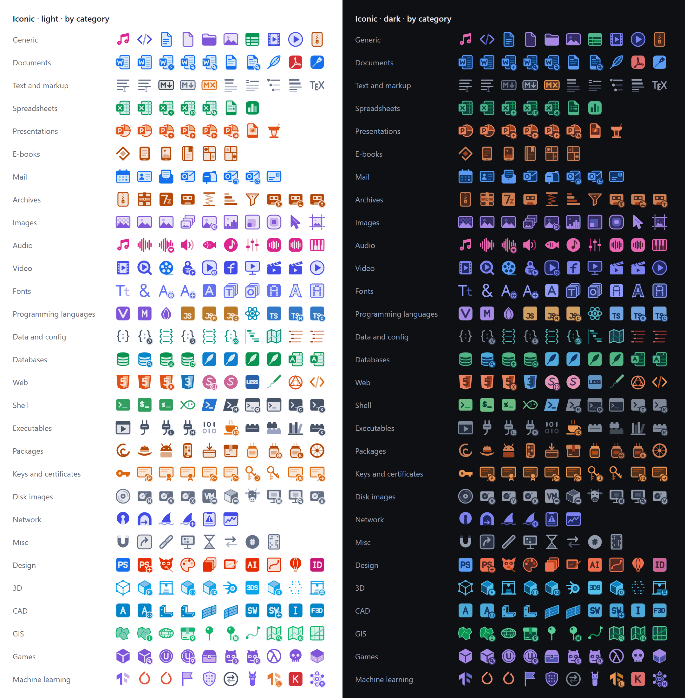

# Filecon

File-type icons for **703 formats** in nine styles – for every framework. [filecon.dev](https://filecon.dev)

- **9 styles**: `default` (outline, colored label), `gray` (filled gray page), `solid` (filled colored page),
  `papered` (realistic paper sheet), `papered-flat` (flat paper), `papered-craft` (cut paper),
  `scratch` (pencil sketch on a note, handwritten label), `chalk` (whiteboard marker in light, blackboard chalk in dark),
  `iconic` (a standalone, self-drawn symbol per file type instead of a page shape; redrawn marks for brand formats; light and dark)
- **Light, dark and `auto`** (follows `prefers-color-scheme`, SSR-safe, no hydration mismatch)
- **Smart resolver**: file name → magic bytes → extension (`Thumbs.db`, `Dockerfile`, SQLite vs. generic `.db`,
  MPEG-TS vs. TypeScript `.ts`, …)
- **Tree-shakable** single icons (`PdfIcon`, `TsStreamIcon`, `Icon7z`, …) and single-style packages for small bundles
- Accessible by default: `aria-hidden` without `title`, `role="img"` + `<title>` with it
- Apache-2.0, labels embedded as paths (no font needed; the handwriting of `scratch`/`chalk` is Patrick Hand,
  OFL-1.1, converted to outlines); no third-party logos except the redrawn brand marks of `iconic` (see `NOTICE`)

## Preview


Each style in detail – a grid, a category overview and the VS Code icon theme, light and dark: [docs/previews](docs/previews#readme).



## Packages

| Package | |
|---|---|
| [`@filecon/shared`](packages/shared) | SVG files, manifest, types, resolver |
| [`@filecon/js`](packages/js) | framework-free: `getIcon()` → SVG string |
| [`@filecon/react`](packages/react) | React components (SSR/RSC-safe) |
| [`@filecon/preact`](packages/preact) | Preact components |
| [`@filecon/react-native`](packages/react-native) | React Native / Expo via `react-native-svg` |
| [`@filecon/vue`](packages/vue) | Vue 3 components (render functions, no SFC build) |
| [`@filecon/svelte`](packages/svelte) | Svelte 5 components |
| [`@filecon/solid`](packages/solid) | SolidJS components |
| [`@filecon/angular`](packages/angular) | Angular standalone component `<filecon-icon>` |
| [`@filecon/astro`](packages/astro) | Astro components (zero client JS) |
| [`@filecon/elements`](packages/elements) | Web Components: `<filecon-icon name="pdf">` for plain HTML and any framework |
| [`@filecon/electron`](packages/electron) | Electron: `iconForPath()` in main, IPC handlers, typed preload bridge |
| [`@filecon/tauri`](packages/tauri) | Tauri 2 JS binding for `tauri-plugin-filecon` (desktop, iOS, Android) |
| [`@filecon/iconify`](packages/iconify) | Iconify JSON icon sets for UnoCSS, `unplugin-icons`, Tailwind, Iconify |
| [`@filecon/css`](packages/css) | CSS classes (`.filecon.filecon-pdf`) with data-URI backgrounds, no JS |
| [`filecon`](crates/filecon) (crates.io) | Rust crate: embedded SVGs (`svg()`), `resolve()`, `names()` |
| [`filecon-dioxus`](crates/filecon-dioxus) (crates.io) | Dioxus component `FileIcon` (web, desktop, mobile) |
| [`tauri-plugin-filecon`](crates/tauri-plugin-filecon) (crates.io) | Tauri 2 plugin: resolve + SVG in Rust, `iconForPath` with magic bytes |
| [`filecon-icons`](extensions/vscode) (VS Code) | File icon theme for VS Code / Open VSX (9 themes) – prepared |
| [`filecon`](ports/python) (PyPI) | Python: `svg()`, `resolve()`, `names()` – prepared |

Every framework package (and `@filecon/elements`) exists in ten flavors: `@filecon/<fw>` (all styles, `style`
prop) and `@filecon/<fw>-default`, `-gray`, `-solid`, `-papered`, `-papered-flat`, `-papered-craft`, `-scratch`,
`-chalk`, `-iconic` (one style each, same API without `style`).
"prepared" = built and tested in this repository, not yet published (see [`docs/publishing.md`](docs/publishing.md)).

## Quick start

```sh
npm install @filecon/react
```

```tsx
import { FileIcon } from "@filecon/react";
import { PdfIcon } from "@filecon/react/icons";

<FileIcon name="pdf" />
<FileIcon file="report.final.pdf" />
<FileIcon name="db-sqlite" style="solid" theme="dark" size={48} />
<FileIcon name="png" theme="auto" title="PNG image" />
<PdfIcon size={24} />
```

Rust:

```rust
let name = filecon::resolve("app.db", Some(&head));      // "db-sqlite"
let svg = filecon::svg(name, filecon::Style::Solid, filecon::Theme::Dark);
```

Without a framework:

```ts
import { getIcon, getFileIcon } from "@filecon/js";

element.innerHTML = getIcon("pdf", { style: "gray", theme: "dark" });
element.innerHTML = getFileIcon("data.db", { head: firstKilobyte }); // SQLite -> db-sqlite
```

## Development

Requirements: Node ≥ 22.18, pnpm 11 (Rust stable for the crate). The repository must be on a file system with
symlink support.

```sh
pnpm install
pnpm lint && pnpm typecheck && pnpm build && pnpm test
```

- `icon-pack/` is the read-only source of truth. Generated code (`src/generated/`) is created by `pnpm codegen`
  (part of `build`/`typecheck`) and never committed.
- Framework packages are generated from `tools/templates/<fw>/`: a new framework is just a new template.
- See [`CLAUDE.md`](CLAUDE.md) for conventions and [`ISSUES.md`](ISSUES.md) for known issues.

## License

Apache-2.0, see [`LICENSE`](LICENSE) and [`NOTICE`](NOTICE). The label glyphs are outlines of Inter Bold
(SIL Open Font License 1.1).
