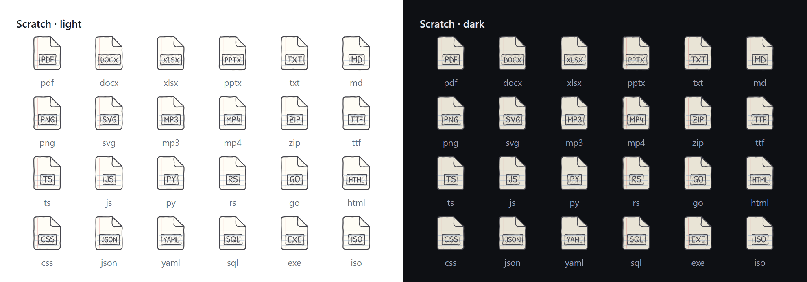
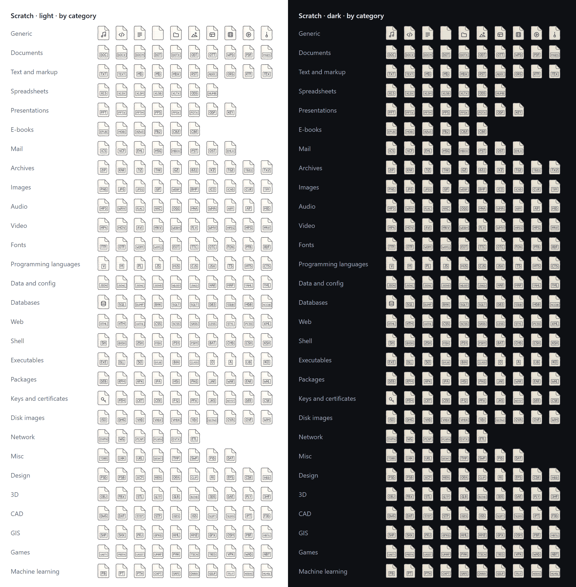

# @filecon/angular-scratch

[Filecon](https://filecon.dev) file icons for Angular – 703 file types, the scratch style (pencil sketch on a note sheet).
Standalone component `<filecon-icon>`, signal inputs, OnPush, SSR-safe.

Part of the Filecon family: `@filecon/angular`, `@filecon/angular-default`, `@filecon/angular-gray`, `@filecon/angular-solid`, `@filecon/angular-papered`, `@filecon/angular-papered-flat`, `@filecon/angular-papered-craft`, `@filecon/angular-scratch`, `@filecon/angular-chalk`, `@filecon/angular-iconic`.
This package only contains the `scratch` style, so it is smaller than `@filecon/angular`; the API is identical except that there is no `iconStyle` input.



```sh
npm install @filecon/angular-scratch
```

## Usage

```ts
import { Component } from "@angular/core";
import { FileconIconComponent, PdfIcon } from "@filecon/angular-scratch";

@Component({
  selector: "app-files",
  imports: [FileconIconComponent],
  template: `
    <filecon-icon name="pdf" />
    <filecon-icon file="report.final.pdf" />
    <filecon-icon name="db-sqlite" theme="dark" [size]="48" />
    <filecon-icon name="png" theme="auto" title="PNG image" />
    <filecon-icon [icon]="pdfIcon" [size]="24" />
  `,
})
export class FilesComponent {
  readonly pdfIcon = PdfIcon;
}
```

## Inputs

| Input | Type | Default | |
|---|---|---|---|
| `name` | `IconName \| string` | – | icon name or extension |
| `file` | `string` | – | file name, resolved with `resolveIcon` |
| `icon` | `FileconIcon` | – | single icon such as `PdfIcon` (tree-shakable) |
| `theme` | `"light" \| "dark" \| "auto"` | `"light"` | `auto` embeds a `prefers-color-scheme` stylesheet – no hydration mismatch |
| `size` | `number \| string` | `40` | width and height |
| `title` | `string` | – | adds `<title>` and `role="img"`; without it the SVG is `aria-hidden="true"` |

Use exactly one of `name`, `file` and `icon`.

## Deviations from the other packages

- **Single icons are definitions, not components.** `PdfIcon`, `TsStreamIcon`, `Icon7z`, … (also importable from
  `@filecon/angular-scratch/icons`) are `{ name, data }` objects for the `icon` input. Generating 703 Angular components
  would bloat the partially compiled bundle; unused definitions are tree-shaken like components.
- **`iconStyle` instead of `style`**: `style` is the CSS binding of the host element in Angular.
- **Host element**: the `<svg>` is rendered inside `<filecon-icon>` (`display:inline-flex`). `class` and `style`
  apply to the host.
- The SVG is inserted with `bypassSecurityTrustHtml`. This is safe because the markup is static package content and
  `title` is escaped.
- Built with `ng-packagr` (partial compilation, FESM2022) instead of `tsup`, as required for Angular libraries.

## Preview by category



## License

Apache-2.0 – see `LICENSE` and `NOTICE`. Label glyphs are outlines of Inter Bold (SIL OFL 1.1).
