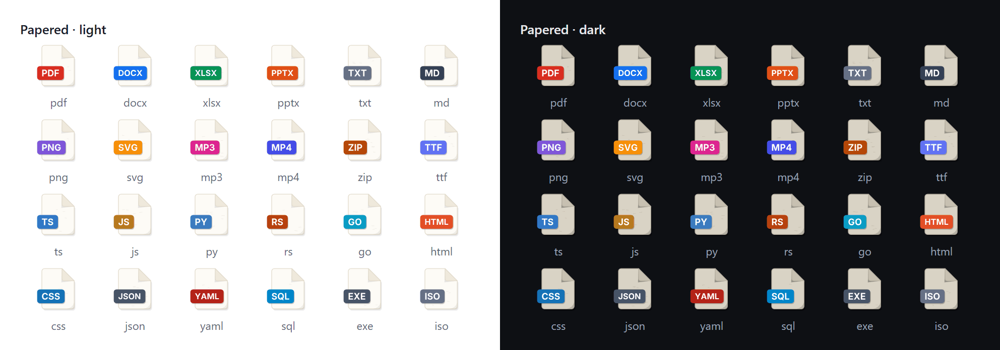
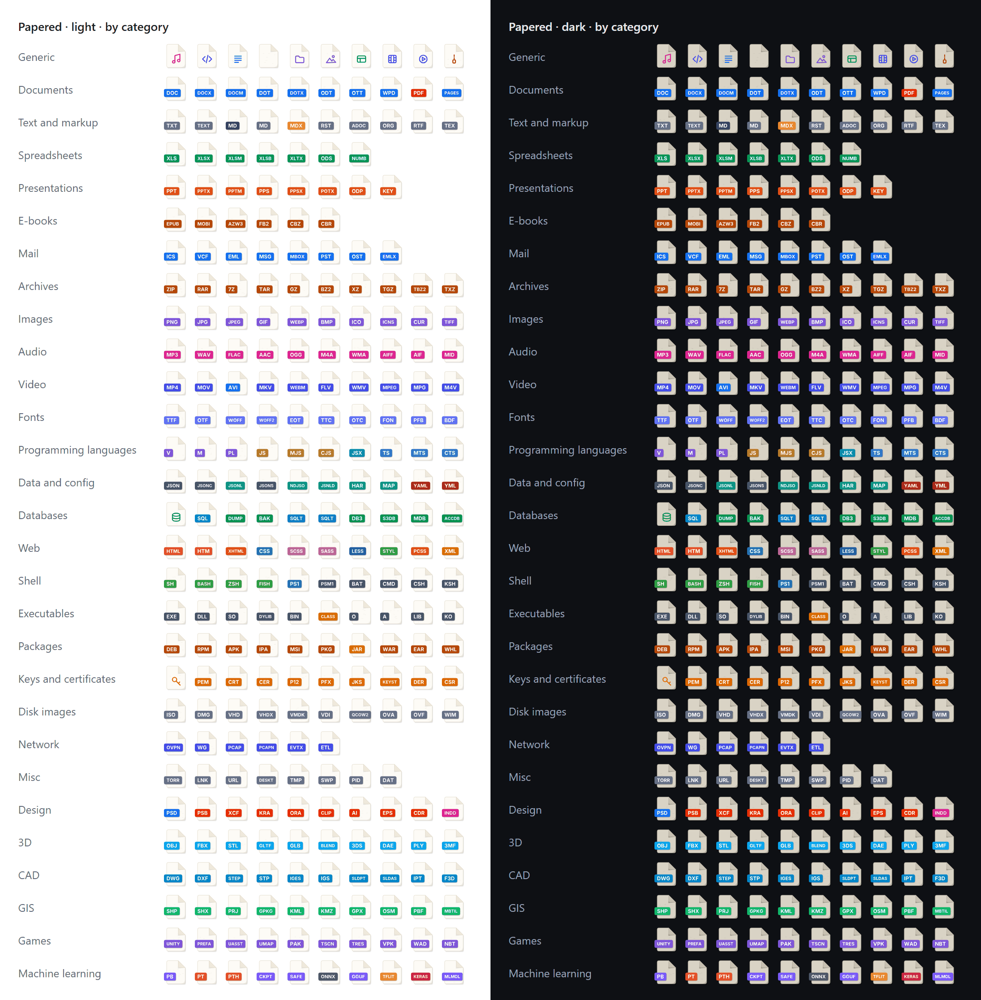

# @filecon/astro-papered

[Filecon](https://filecon.dev) file icons for Astro – 703 file types, the papered style (realistic sheet of paper).
Rendered at build/request time as inline SVG – zero client-side JavaScript.

Part of the Filecon family: `@filecon/astro`, `@filecon/astro-default`, `@filecon/astro-gray`, `@filecon/astro-solid`, `@filecon/astro-papered`, `@filecon/astro-papered-flat`, `@filecon/astro-papered-craft`, `@filecon/astro-scratch`, `@filecon/astro-chalk`, `@filecon/astro-iconic`.
This package only contains the `papered` style, so it is smaller than `@filecon/astro`; the API is identical except that there is no `style` prop (`style` is the regular inline-CSS attribute here).



```sh
npm install @filecon/astro-papered
```

## Usage

```astro
---
import { FileIcon } from "@filecon/astro-papered";
import { PdfIcon, TsStreamIcon, Icon7z } from "@filecon/astro-papered/icons";
---

<FileIcon name="pdf" />
<FileIcon file="report.final.pdf" />
<FileIcon name="db-sqlite" theme="dark" size={48} />
<FileIcon name="png" theme="auto" title="PNG image" />
<PdfIcon size={24} class="icon" />
```

## Props

| Prop | Type | Default | |
|---|---|---|---|
| `name` | `IconName \| string` | – | icon name or extension (exclusive with `file`) |
| `file` | `string` | – | file name, resolved with `resolveIcon` (exclusive with `name`) |
| `theme` | `"light" \| "dark" \| "auto"` | `"light"` | `auto` embeds a `prefers-color-scheme` stylesheet |
| `size` | `number \| string` | `40` | width and height |
| `title` | `string` | – | adds `<title>` and `role="img"`; without it the SVG is `aria-hidden="true"` |
| `class`, … | SVG attributes | – | forwarded to `<svg>` |

## Notes

- Astro components are distributed as `.astro` source files and compiled by your project (standard for Astro
  libraries). The TypeScript helpers are precompiled with `tsc`; there is no bundler step.
- Single icons are one small `.astro` file each; only the ones you import end up in your build.

## Preview by category



## License

Apache-2.0 – see `LICENSE` and `NOTICE`. Label glyphs are outlines of Inter Bold (SIL OFL 1.1).
