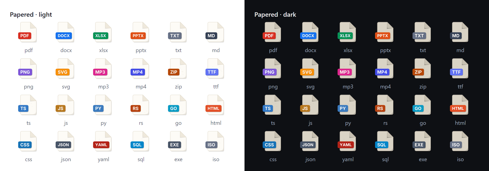
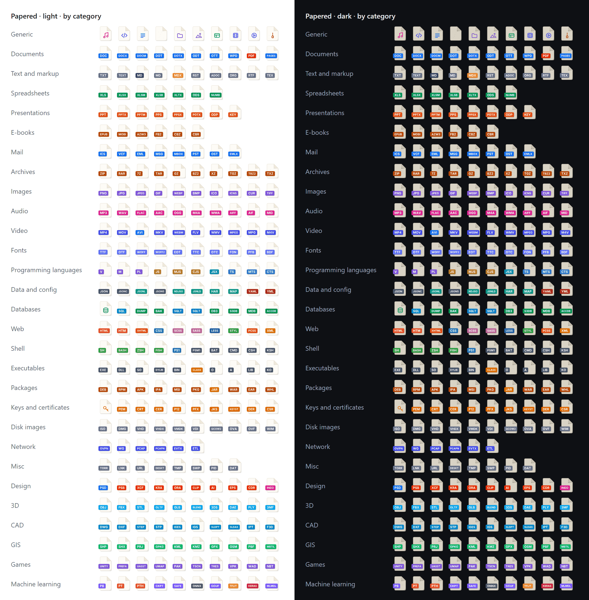

# @filecon/elements-papered

[Filecon](https://filecon.dev) file icons as Web Components – 703 file types, the papered style (realistic sheet of paper).
Works in plain HTML and with any framework (Lit, Qwik, Ember, HTMX, Rails/Django templates, …).

Part of the Filecon family: `@filecon/elements`, `@filecon/elements-default`, `@filecon/elements-gray`, `@filecon/elements-solid`, `@filecon/elements-papered`, `@filecon/elements-papered-flat`, `@filecon/elements-papered-craft`, `@filecon/elements-scratch`, `@filecon/elements-chalk`, `@filecon/elements-iconic`.
This package only contains the `papered` style, so it is smaller than `@filecon/elements`; the API is identical except that there is no `icon-style` attribute.



```sh
npm install @filecon/elements-papered
```

## Usage

```ts
import "@filecon/elements-papered/define"; // registers <filecon-icon>
```

```html
<filecon-icon name="pdf"></filecon-icon>
<filecon-icon file="report.final.pdf" theme="auto" size="24"></filecon-icon>
<filecon-icon name="db-sqlite" label="SQLite database"></filecon-icon>
```

Or register it yourself (e.g. under another tag name):

```ts
import { defineFileconIcon, FileconIconElement } from "@filecon/elements-papered";

defineFileconIcon();              // <filecon-icon>
defineFileconIcon("file-icon");   // <file-icon>
```

## Attributes

| Attribute | Property | Default | |
|---|---|---|---|
| `name` | `name` | – | icon name or extension (`pdf`, `.PDF`, `db-sqlite`); unknown names render `empty` |
| `file` | `file` | – | file name, resolved via the Filecon resolver (ignored when `name` is set) |
| `theme` | `theme` | `light` | `light`, `dark` or `auto` (embedded `prefers-color-scheme` stylesheet) |
| `size` | `size` | `40` | width and height of the `<svg>` |
| `label` | `label` | – | accessible name: adds `<title>` and `role="img"`; without it the SVG is `aria-hidden="true"` |
| `svg-class` | – | – | `class` attribute of the rendered `<svg>` |

The `<svg>` is rendered into the light DOM (no shadow root), so you can style it with normal CSS.
Importing the package during SSR is safe; the icon renders when the element is upgraded in the browser.

## Single icons (tree-shakable)

`<filecon-icon>` contains the data of all icons. To ship only the icons you use:

```ts
import { defineIcons } from "@filecon/elements-papered";
import { PdfIcon, ZipIcon } from "@filecon/elements-papered/icons";

defineIcons(PdfIcon, ZipIcon); // <filecon-pdf>, <filecon-zip>
// or: customElements.define("my-pdf", PdfIcon);
```

```html
<filecon-pdf theme="dark" size="32"></filecon-pdf>
```

## Preview by category



## License

Apache-2.0 – see `LICENSE` and `NOTICE`. Label glyphs are outlines of Inter Bold (SIL OFL 1.1).
