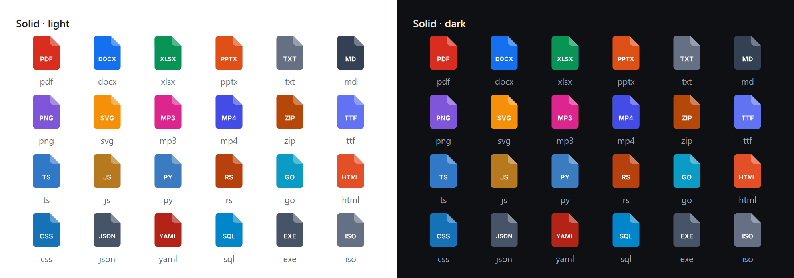
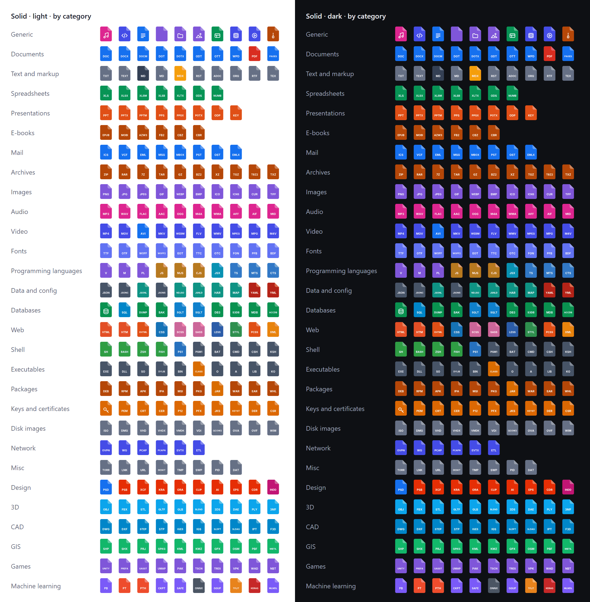

# @filecon/react-solid

[Filecon](https://filecon.dev) file icons for React – 703 file types, the solid style (filled colored page).
SSR-safe (also React Server Components), tree-shakable, no runtime dependencies besides React.

Part of the Filecon family: `@filecon/react`, `@filecon/react-default`, `@filecon/react-gray`, `@filecon/react-solid`, `@filecon/react-papered`, `@filecon/react-papered-flat`, `@filecon/react-papered-craft`, `@filecon/react-scratch`, `@filecon/react-chalk`, `@filecon/react-iconic`.
This package only contains the `solid` style, so it is smaller than `@filecon/react`; the API is identical except that there is no `style` prop (`style` is the regular inline-CSS prop here).



```sh
npm install @filecon/react-solid
```

## Usage

```tsx
import { FileIcon } from "@filecon/react-solid";

<FileIcon name="pdf" />                                  // icon name / extension
<FileIcon file="report.final.pdf" />                     // picked by the resolver (file name only)
<FileIcon name="db-sqlite" theme="dark" size={48} />
<FileIcon name="png" theme="auto" title="PNG image" />   // follows prefers-color-scheme
```

Tree-shakable single icons:

```tsx
import { PdfIcon, TsStreamIcon, Icon7z } from "@filecon/react-solid/icons";

<PdfIcon size={24} className="icon" />
```

Component names are PascalCase + `Icon` (`ts-stream` → `TsStreamIcon`); names starting with a digit get an
`Icon` prefix (`7z` → `Icon7z`). `iconComponentName(name)` returns the name for any icon.

## Props

| Prop | Type | Default | |
|---|---|---|---|
| `name` | `IconName \| string` | – | icon name or extension (exclusive with `file`) |
| `file` | `string` | – | file name, resolved with `resolveIcon` (exclusive with `name`) |
| `theme` | `"light" \| "dark" \| "auto"` | `"light"` | `auto` embeds a `prefers-color-scheme` stylesheet – identical markup on server and client, no hydration mismatch |
| `size` | `number \| string` | `40` | width and height |
| `title` | `string` | – | adds `<title>` and `role="img"`; without it the SVG is `aria-hidden="true"` |
| `className`, … | SVG props | – | forwarded to `<svg>`, `ref` too |

## Notes

- Built with `tsup` (ESM + CJS + `.d.ts`). Components use `createElement`, no JSX runtime needed.
- Icon data comes from `@filecon/js-solid` (only the inner SVG markup is stored once).

## Preview by category



## License

Apache-2.0 – see `LICENSE` and `NOTICE`. Label glyphs are outlines of Inter Bold (SIL OFL 1.1).
