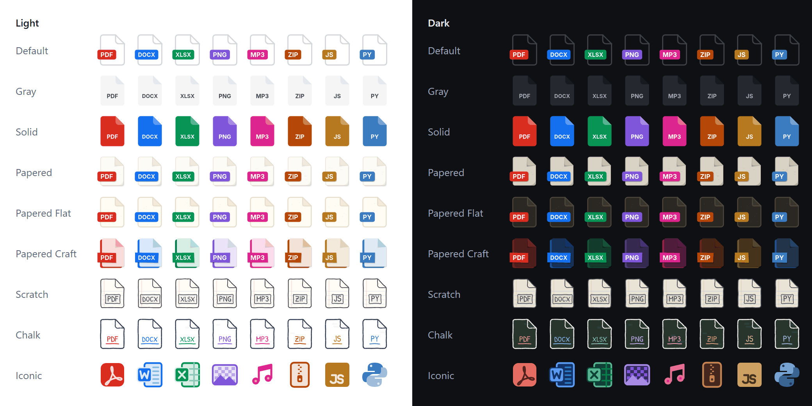

# @filecon/tauri

JavaScript binding of [`tauri-plugin-filecon`](https://crates.io/crates/tauri-plugin-filecon) – [Filecon](https://filecon.dev)
file icons (703 file types) for Tauri 2 apps on desktop, iOS and Android. The Rust side resolves the icon (file
name, magic bytes of the first 1 KB, extension) and returns the SVG; the WebView only renders it.



More previews (a grid and a category overview per style): [docs/previews](https://github.com/dutobo/filecon/tree/main/docs/previews#readme).

```sh
npm install @filecon/tauri
cargo add tauri-plugin-filecon   # in src-tauri/
```

## Setup (Rust)

```rust
// src-tauri/src/lib.rs
tauri::Builder::default()
    .plugin(tauri_plugin_filecon::init())
```

```jsonc
// src-tauri/capabilities/default.json
{
  "permissions": [
    "filecon:default",              // resolve + icon
    "filecon:allow-icon-for-path"   // optional: read the first 1 KB of files for magic-byte detection
  ]
}
```

## Usage (JavaScript)

```ts
import { getIcon, iconForPath, resolveIcon } from "@filecon/tauri";

await resolveIcon("report.final.pdf");                 // "pdf"
const svg = await getIcon("db-sqlite", { style: "solid" });
const { name, svg: icon } = await iconForPath("/data/app.db", { theme: "dark" }); // "db-sqlite" via magic bytes

element.innerHTML = icon;
```

| Function | Command | Permission |
|---|---|---|
| `resolveIcon(fileName)` | `plugin:filecon\|resolve` | `filecon:default` |
| `getIcon(name, { style, theme })` | `plugin:filecon\|icon` | `filecon:default` |
| `iconForPath(path, { style, theme })` | `plugin:filecon\|icon_for_path` | `filecon:allow-icon-for-path` |

`style`: `default` (outline, colored label), `gray`, `solid`, `papered`, `papered-flat`, `papered-craft`, `scratch`, `chalk`, `iconic`; `theme`: `light`, `dark`. The SVGs are the unmodified
pack files (40×40, with `<title>`). For framework components in the WebView you can also use the regular packages
(`@filecon/react`, `@filecon/vue`, …) and only call `resolveIcon`/`iconForPath` for the file detection.

On iOS/Android `iconForPath` needs a real file system path; `content://` URIs fall back to the file name.

## License

Apache-2.0 – see `LICENSE` and `NOTICE`.
